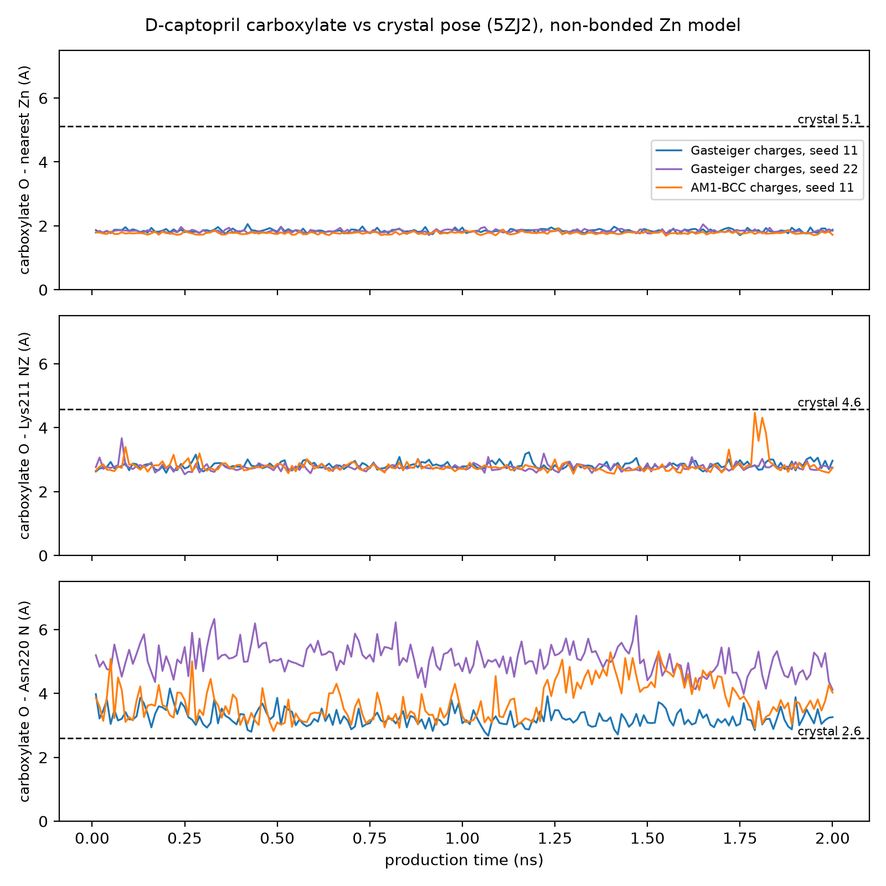
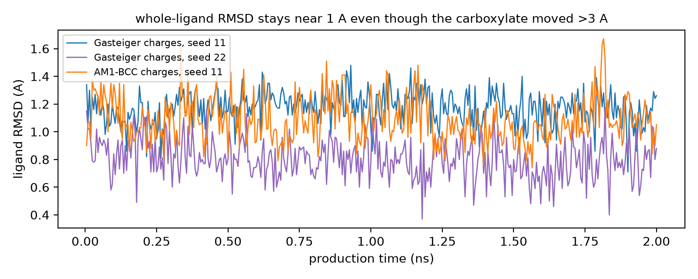

# NDM-1 / D-captopril (PDB 5ZJ2): an OpenMM MD baseline and a documented force-field limitation

A reproducible OpenMM workflow for the metallo-beta-lactamase NDM-1 bound to D-captopril (PDB 5ZJ2): system set-up, restrained equilibration, production MD with checkpoint/resume, and analysis scripts.

The main outcome is a documented limitation. With a non-bonded Zn(2+) model, the ligand carboxylate does not stay where the crystal puts it. In the crystal it is 5.1 A from the nearest Zn; in every simulation it ends up about 1.8 A from Zn (100 % of frames) and forms a salt bridge with Lys211, while the crystal contact with the Asn220 backbone NH is lost or weakened. Whole-ligand RMSD stays near 1 A and hides this.

## Results (three production runs, 2 ns each)

Distances are for the nearer carboxylate oxygen, in Angstrom. Residue numbers are PDB numbers (the MD files are renumbered from 1: PDB number = MD number + 41).

| run | carboxylate O-Zn mean (A) | frames <= 3.0 A | O-Lys211 NZ mean (A) | frames <= 3.5 A | O-Asn220 N mean (A) | frames <= 3.5 A | ligand RMSD mean (A) |
|---|---|---|---|---|---|---|---|
| crystal pose (5ZJ2) | 5.11 | - | 4.57 | - | 2.59 | - | - |
| Gasteiger charges, seed 11 | 1.85 | 100% | 2.82 | 100% | 3.23 | 85% | 1.17 |
| Gasteiger charges, seed 22 | 1.83 | 100% | 2.77 | 100% | 5.05 | 0% | 0.81 |
| AM1-BCC charges, seed 11 | 1.77 | 100% | 2.79 | 98% | 3.76 | 40% | 1.09 |

What the runs show:

- The thiolate sulfur stays between the two Zn ions (restrained to the crystal distances, 2.3 A).

- The carboxylate collapse is reproducible: two seeds with the original (Gasteiger) charges and one run with AM1-BCC charges all end with a carboxylate oxygen about 1.8 A from Zn.

- Changing the ligand charges altered details (Asn220 and Phe70 contacts) but not the collapse. A minimization-only test (crystal pose, AM1-BCC charges) kept the carboxylate 4.1-4.3 A from Zn, yet 2 ns of dynamics moved it to 1.8 A: a local minimum is not evidence of stability.

- Zn ligands Asp124 and Cys208 are also compressed (1.8 and 2.1 A against 1.9 and 2.3 A in the crystal; Gasteiger run, seed 11), the usual signature of an unrestrained +2 point charge.

## System and protocol

- Structure: PDB 5ZJ2 (NDM-1, two Zn, D-captopril). The ligand is the thiolate/carboxylate dianion (net charge -2), built from the crystal coordinates with RDKit; stereochemistry checked (ring R, chain S).

- Solvated cubic box (64.7 A edge), 27,156 atoms, neutralised.

- OpenMM with an amber14-based force field (see scripts/md_prep.py), 2 fs step, NPT at 300 K and 1 bar (Langevin middle integrator, Monte Carlo barostat).

- Zn ions are non-bonded (charge +2). Coordination is held by harmonic restraints (40000 kJ/mol/nm^2) to the crystal distances for the Zn ligands, including the ligand sulfur.

- Equilibration: 5 x 50 ps with heavy-atom position restraints released stepwise (1000 to 0 kJ/mol/nm^2). Production: 2 ns, frame every 10 ps.

- Ligand charges: runs 1-2 Gasteiger on atom types borrowed from amber14; run 3 AM1-BCC (antechamber/sqm; GAFF2 parameters in ligand/) mapped onto the same atom types.

- Speed: 47-92 min per 2.25 ns run (about 35-70 ns/day) on a laptop GPU (OpenCL).

## Limitations

- Baseline, not validated: ligand atom types are borrowed, Zn is non-bonded, and no QM-derived parameters are used.

- Short (2 ns) with few replicates (Gasteiger: 2 seeds; AM1-BCC: 1 seed).

- Contacts are distance-based, not proven hydrogen bonds. Distances involving Zn-bound atoms are geometric consequences of the Zn shell.

- The results describe this model. They are not evidence for the binding mode of captopril in NDM-1.

## Next steps

A bonded Zn model (for example MCPB.py with RESP charges from a QM calculation of the dinuclear site), longer runs with more seeds, and the same acceptance test: the carboxylate should stay more than 3.5 A from Zn over 2 ns and keep its Asn220 contact.

## Reproduce

Needs OpenMM, NumPy and RDKit (matplotlib for the figures; AmberTools for the AM1-BCC step). Some scripts contain absolute paths (C:\NDM1_Project\md); edit them for your machine.

    python scripts/md_prep.py inputs/5ZJ2_oxt.pdb inputs/mco_crystal.pdb

    python scripts/md_run.py 2.0 40000 --seed 11

    python scripts/md_run.py 2.0 40000 --rep r2 --seed 22

    python scripts/make_figures.py

## Layout

- scripts/ : set-up, MD driver (checkpoint/resume, seeds, replicates), analysis, plotting

- ligand/ : GAFF2 / AM1-BCC parameters of D-captopril (crystal pose)

- inputs/ : structure files used

- results/ : per-run summaries (CSV) and the results table

- figures/ : plots used above

Data: PDB 5ZJ2. Tools: OpenMM, RDKit, AmberTools.

